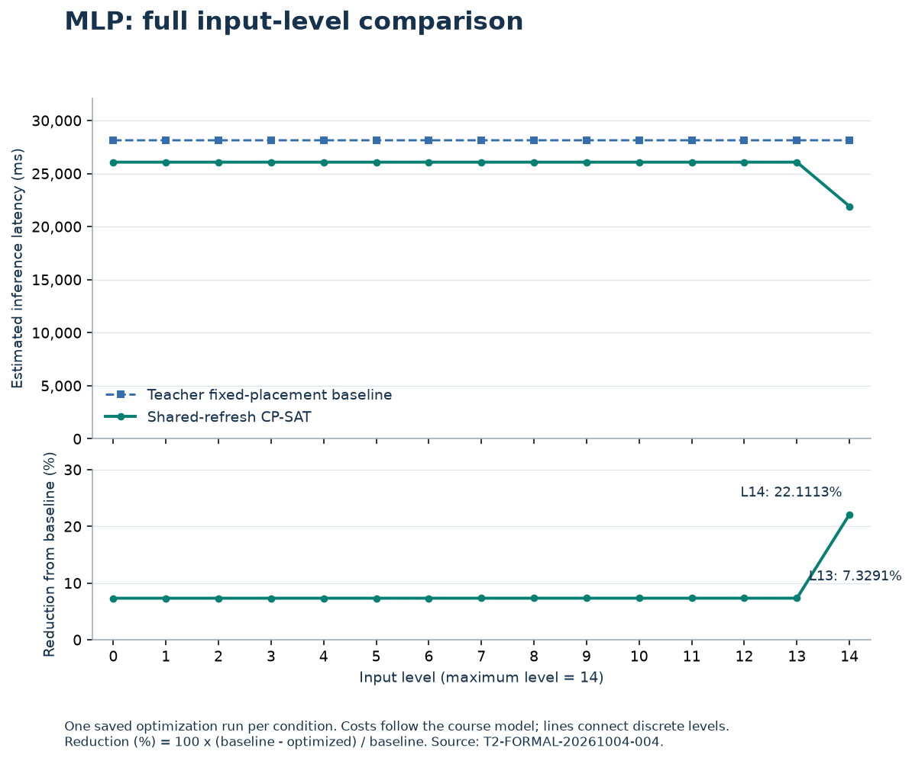
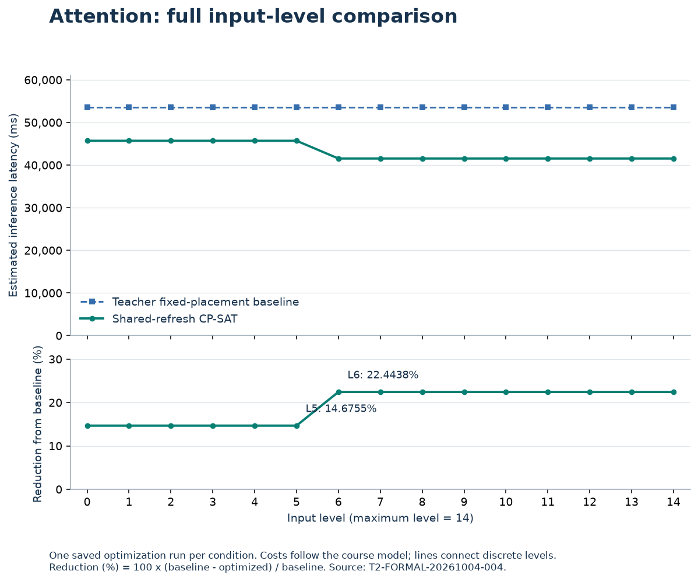
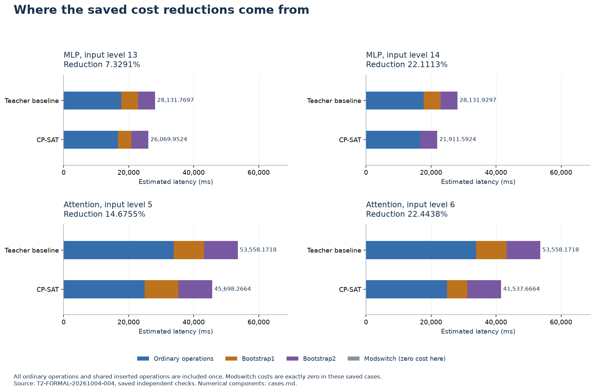

# Formal comparison and placement analysis

The saved formal experiment covers two fixed encrypted-computation graphs, a multilayer perceptron (MLP) and Attention, at all 15 input levels from 0 to 14. Every optimized placement has a lower **estimated inference latency** than the teacher's fixed placement under the same input condition. The reductions range from 7.3223% to 22.1113% for MLP and from 14.6755% to 22.4438% for Attention. These are costs from the course model; they describe 30 conditions on two graphs, rather than measured encrypted executions or 30 different networks.

## What is being optimized

An encrypted value has a level that limits how much computation can follow it. Ordinary operators consume levels. A refresh restores levels at a substantial cost, while a modulus switch (Modswitch) lowers a level at zero cost in this model. Placement therefore affects both refresh cost and the level-dependent cost of later ordinary operators. A cheap placement must keep every operation legal while controlling their combined cost.

The teacher supplies the graphs, latency functions and scoring interface. The project's shared-refresh formulation chooses edge delivery levels and refresh decisions using Google's OR-Tools CP-SAT, a general constraint-programming search engine. The project implements the formulation, shared-node reconstruction and checks; CP-SAT supplies the search. A refresh used by multiple outgoing edges from one producer is represented and charged once. Bootstrap1 restores level 14 and is counted per ciphertext. Bootstrap2 restores level 13, is permitted only for 8 or 16 ciphertexts here, and is counted per pair. The objective includes ordinary operators and both refresh types, rather than minimizing refresh count alone.

The verified teacher baseline also supplies search hints and a feasible cost upper bound. The formal configurations fix maximum level 14, one search worker, seed 5491 and a 60-second search ceiling per condition. Each condition has one saved formal optimization run and its saved-result check. All 30 record `OPTIMAL`, equal objective and bound, zero gap and a passed check. This certifies the encoded course-model solutions; it does not establish performance outside the supplied graphs and cost functions. See the [method formulation](../../docs/s2-method.md#variables-and-constraints), [formal protocol](../T2-FORMAL-20261004-004/protocol.json) and [evidence index](evidence-index.md).

## Full comparison

The curves show every saved condition, including both sides of each change in optimized cost. The upper panel compares estimated latency; the lower panel uses `100 × (baseline − optimized) / baseline` for that same condition. Lines connect discrete input levels. With one run per condition, these figures contain no repeated-run variance or statistical significance estimate.

| Graph | Input levels | Teacher baseline (ms) | Optimized (ms) | Reduction (%) |
|---|---|---:|---:|---:|
| MLP | 0–13 | 28129.6897–28131.7697 | 26069.9524 | 7.3223–7.3291 |
| MLP | 14 | 28131.9297 | 21911.5924 | 22.1113 |
| Attention | 0–5 | 53558.1718 | 45698.2664 | 14.6755 |
| Attention | 6–14 | 53558.1718 | 41537.6664 | 22.4438 |

**Figure 1.** MLP has a constant optimized cost through input level 13 and a lower cost at level 14. The baseline's small variation is retained in the [full table](comparison.md), even though it is hard to distinguish at this scale. [SVG](figures/comparison-mlp.svg) · [plotted data](figures/comparison-mlp.data.json).

**Figure 2.** Attention changes from 45698.2664 ms to 41537.6664 ms between input levels 5 and 6; the latter total persists through level 14. A cost plateau does not imply identical placements at every level. [SVG](figures/comparison-attention.svg) · [plotted data](figures/comparison-attention.data.json).

The [readable comparison](comparison.md) includes all 30 costs, components, counts, level metrics and statuses. [CSV](comparison.csv) and [JSON](comparison.json) retain the source precision; displayed percentages are rounded to four decimal places. The [data dictionary](data-dictionary.md) defines their units and counting conventions.

## Why the representative costs differ

Four saved cases straddle the observed changes. Figure 3 separates ordinary-operator costs from refresh costs, so a change in the number of refreshes cannot obscure changes elsewhere in the graph. Modswitch contributes zero under this cost model.

**Figure 3.** Each pair uses the same graph and input level. Colors distinguish cost components; labels at the ends of the bars give total estimated latency in milliseconds. Detailed component values and course refresh counts are provided in [cases.md](cases.md). [SVG](figures/cost-components.svg) · [plotted data](figures/cost-components.data.json).

For **MLP at input level 13**, ordinary operations save 1021.6673 ms and Bootstrap1 saves 1040.15 ms relative to its baseline. Bootstrap2 is unchanged, giving a total saving of 2061.8173 ms. The saved placement refreshes four ciphertexts after `Conj_X_mlp` and applies Bootstrap2 after `Add_res_mlp`. At **input level 14**, the early Bootstrap1 is absent. Comparing these two optimized solutions, its removal saves 4160.60 ms, while the conjugation costs 2.24 ms more; all other ordinary-node costs match. The net optimized-cost decrease is therefore 4158.36 ms. Against its own level-14 baseline, the saving is 6220.3373 ms (22.1113%).

For **Attention at input level 5**, ordinary operations save 8900.0554 ms, outweighing an additional 1040.15 ms of Bootstrap1 cost. Bootstrap2 is unchanged, leaving a net saving of 7859.9054 ms (14.6755%). The course refresh count actually rises from 17 to 18. One large contributor is `iter1_invsqrt_attn`: its recorded ordinary-operation cost falls from 8691.15 to 5317.53 ms. The [node-cost breakdown](case-explanations.json) includes both increases and decreases, rather than only favorable examples.

At **Attention input level 6**, the saved solution omits the four-ciphertext Bootstrap1 after `X_in_attn`. Its other shared refreshes and ordinary-node costs match the level-5 solution. This removes 4160.60 ms, producing 41537.6664 ms in total and a saving of 12020.5054 ms against its baseline (22.4438%). Some zero-cost switch choices also differ. These explanations reconcile the two saved solutions; they are not additional controlled experiments or evidence of a unique optimum.

## Reading the complete placements

Each diagram contains the entire saved reconstructed directed acyclic graph. Boxes show an operation and its input/output levels. Edge labels give the producer's level `L` and ciphertext count `ct`; a merge uses the minimum incoming level. Long amber routes preserve residual and other long connections. A shared refresh is one box with multiple outgoing uses where applicable. Node display names replace underscores with spaces and omit common prefixes/suffixes; exact identifiers remain in each SVG's element IDs and its data file.

| Figure | Condition | Nodes / edges | Vector | Raster | Exact graph and labels |
|---|---|---:|---|---|---|
| 4 | MLP, level 13 | 27 / 29 | [SVG](figures/placement-mlp-L13.svg) | [PNG](figures/placement-mlp-L13.png) | [JSON](figures/placement-mlp-L13.data.json) |
| 5 | MLP, level 14 | 25 / 27 | [SVG](figures/placement-mlp-L14.svg) | [PNG](figures/placement-mlp-L14.png) | [JSON](figures/placement-mlp-L14.data.json) |
| 6 | Attention, level 5 | 72 / 79 | [SVG](figures/placement-attention-L05.svg) | [PNG](figures/placement-attention-L05.png) | [JSON](figures/placement-attention-L05.data.json) |
| 7 | Attention, level 6 | 70 / 77 | [SVG](figures/placement-attention-L06.svg) | [PNG](figures/placement-attention-L06.png) | [JSON](figures/placement-attention-L06.data.json) |

Open the SVGs with zoom for the long Attention graphs. Their spatial layout is for inspection and carries no timing meaning. Diagram box counts differ from the course's ciphertext-based refresh counts. For example, MLP level 13 has one Bootstrap1 box counted as four ciphertexts and one Bootstrap2 box counted as four pairs, for a total count of eight.

The additional level metrics describe the course accounting: depth is the largest accumulated ordinary-operation level consumption along a path; budget is `14 × B1 + 13 × B2 + input level`; utilisation is `depth / budget`. MLP depth is 26 and Attention depth is 62. These are distinct from CPU utilisation and from latency. Attention level 5 improves latency even while its utilisation ratio falls from about 0.263830 to 0.248996.

## Computation resources

The following are original local observations from the formal experiment. They measure producing and checking placements, separately from the estimated inference latency above. The [per-condition resource table](resource-observations.md) and [unrounded resource record](resource-observations.json) retain the detailed scopes.

| Recorded scope | Observation |
|---|---:|
| Complete attempt windows: 6 gates, 30 solves, 30 saved-result checks | 201.9114114 s in total |
| CPU over all 265 controlled processes with final records | 220.515625 s |
| Observer CPU, already included in the preceding CPU total | 156.671875 s |
| Sum of 30 measured solver wall intervals | 10.6562887 s |
| Model construction, within the core intervals | 0.1396830 s |
| Core pipeline wall / CPU | 10.8578293 s / 10.75 s |
| Saved-check body wall, within check attempts | 8.5295866 s |
| Largest sampled core RSS | 123621376 bytes (117.895 MiB) |
| Largest observed simultaneous sum over held processes | 128081920 bytes (122.148 MiB) |

Nested body, solver and observer intervals must not be added to their outer totals. The attempt-wall sum is not the project's total elapsed engineering time. The held-process memory observation excludes the observer, app and tool host; individual process lifetime peaks are not simultaneous. Sampling targeted 20 ms, with a largest observed gap of 0.1952339 s, so the observations can miss short peaks. Historical incomplete records do not support a complete historical CPU or memory total. These measurements characterize this recorded local run, not other devices.

## Reuse and limits

This package derives tables and figures from immutable saved results. The [generation instructions](generation.md) identify the executed command, environment versions, checker and expected outputs; the [evidence index](evidence-index.md) connects conclusions to figures, cases, configurations and hashes. Generation succeeded locally, and all 30 derived rows and four complete diagrams passed file checks. This establishes the saved-data derivation, while independent-environment numerical reproduction remains outstanding.

The conclusions cover the two supplied graphs and their course latency functions. There is no measured FHE execution, repeated-run statistical comparison, optional combined-block result or comparison against additional optimization methods here. Formal reports can use these results after their own versioned update and review; older reports and early experimental figures remain evidence of their original versions.
